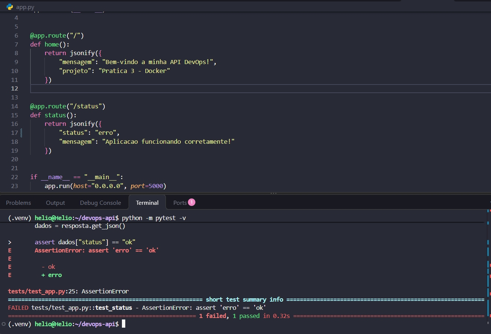
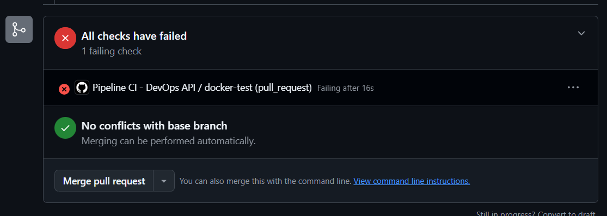
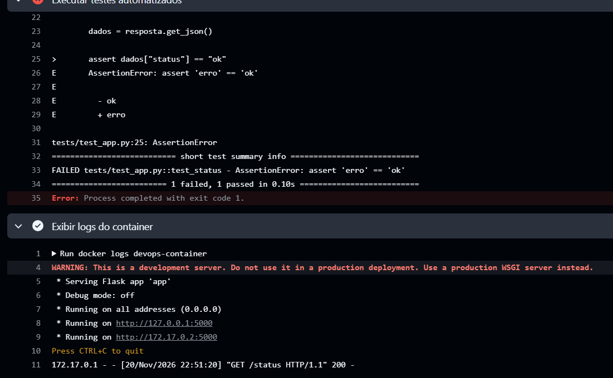
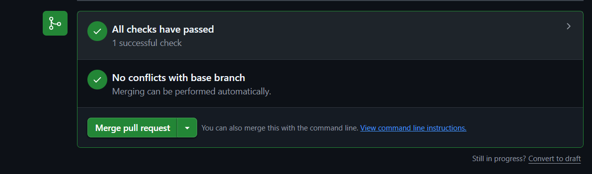
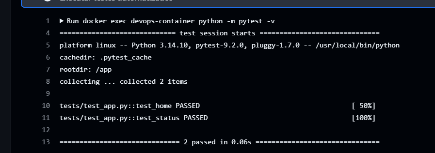

# DevOps API — Práticas 3 e 4

## Sobre o projeto

Este projeto foi desenvolvido como parte das atividades práticas
da disciplina de DevOps do curso de Análise e Desenvolvimento
de Sistemas da Universidade Veiga de Almeida (UVA).

O objetivo é demonstrar a conteinerização de uma aplicação
Python utilizando Docker e a implementação de integração
contínua com GitHub Actions.

## Tecnologias utilizadas

- Python 3.14
- Flask 3.1.3
- Docker
- Ubuntu (WSL 2)
- Git e GitHub
- GitHub Actions
- Pytest

## Funcionalidades

A aplicação disponibiliza dois endpoints:

| Endpoint | Descrição |
|----------|-----------|
| `/` | Retorna uma mensagem de boas-vindas |
| `/status` | Verifica o funcionamento da aplicação |

## Prática 3 — Aplicação com Docker

### Construir a imagem

```bash
docker build -t devops-api .
```

### Executar o contêiner

```bash
docker run -d --name devops-container -p 5000:5000 devops-api
```

### Verificar o contêiner

```bash
docker ps
```

### Testar a aplicação

Acesse no navegador:

- http://localhost:5000
- http://localhost:5000/status

### Parar o contêiner

```bash
docker stop devops-container
```

### Remover o contêiner

```bash
docker rm devops-container
```

## Evidências da Prática 3

As evidências demonstram:

### 1. Imagem Docker construída


### 2. Contêiner em execução


### 3. Aplicação funcionando


---

## Prática 4 — Integração Contínua com GitHub Actions

### Objetivo

Implementar um pipeline de integração contínua utilizando
GitHub Actions para automatizar a construção da imagem Docker,
a execução do contêiner e os testes da aplicação.

O workflow está configurado no arquivo:

`.github/workflows/ci.yml`

### Funcionamento do pipeline

O GitHub Actions executa automaticamente as seguintes etapas:

1. Baixa o código do repositório.
2. Constrói a imagem Docker da aplicação.
3. Inicia o contêiner Docker.
4. Verifica se a API está respondendo.
5. Executa os testes automatizados com Pytest.
6. Apresenta o resultado da execução.

O workflow é acionado automaticamente em pushes na branch
`main` e em Pull Requests direcionados à branch principal.

### Testes automatizados

Os testes estão localizados em `tests/test_app.py`.

Foram desenvolvidos dois testes:

 Teste | Objetivo 

| `test_home` | Verificar se a rota `/` responde com HTTP 200 e retorna o projeto esperado. |
| `test_status` | Verificar se a rota `/status` responde com HTTP 200 e retorna `"status": "ok"`. |

Para executar os testes localmente:

```bash
python -m pytest -v
```

Para executar os testes dentro do contêiner Docker:

```bash
docker exec devops-container python -m pytest -v
```

---

### Simulação de falha proposital

Para demonstrar a capacidade de identificação de erros
pelo pipeline, foi criada a branch `teste-falha-ci`.

No arquivo `app.py`, o retorno da rota `/status`
foi alterado propositalmente.

**Código original:**

```python
"status": "ok"
```

**Código com erro:**

```python
"status": "erro"
```

O teste automatizado `test_status` esperava receber o
valor `"ok"`, mas a aplicação retornou `"erro"`.

Como resultado, o Pytest apresentou:

```text
AssertionError: assert 'erro' == 'ok'

1 failed, 1 passed
```

O GitHub Actions identificou a falha e encerrou
a execução com código de saída 1.

**Resultado: Pipeline com falha (Failure).**

**Link da execução com falha:**

[GitHub Actions — Execução #2 (Failure)](https://github.com/Helio48/devops-api/actions/runs/44832283508)

#### Evidências da falha

**Falha identificada localmente:**



**Pipeline com erro no GitHub Actions:**



**Detalhes do teste que falhou:**



---

### Correção do erro e validação

Após identificar a causa da falha, o código da aplicação
foi corrigido, restaurando o retorno esperado:

```python
"status": "ok"
```

Os testes automatizados foram mantidos sem alterações.

A correção foi registrada em um novo commit e enviada
para a mesma branch `teste-falha-ci`.

O Pull Request foi atualizado automaticamente, iniciando
uma nova execução do GitHub Actions.

**Resultado dos testes:**

```text
tests/test_app.py::test_home PASSED
tests/test_app.py::test_status PASSED

2 passed
```

**Resultado: Pipeline executado com sucesso (Success).**

**Link da execução após a correção:**

[GitHub Actions — Execução #3 (Success)](https://github.com/Helio48/devops-api/actions/runs/44833225872)

#### Evidências da correção

**Pipeline aprovado no GitHub Actions:**



**Detalhes dos testes aprovados:**



---

### Conclusão da Prática 4

A atividade demonstrou o funcionamento da integração
contínua utilizando GitHub Actions, Docker e Pytest.

Foi possível automatizar a construção da aplicação,
executar testes dentro de um contêiner e identificar
uma alteração incorreta no código.

Após a correção, o pipeline foi executado novamente
com sucesso, comprovando a importância dos testes
automatizados para a qualidade e a confiabilidade
do desenvolvimento de software.

---

## Autor

Projeto acadêmico desenvolvido por Helio Anselmo Filho.

Curso: Análise e Desenvolvimento de Sistemas  
Instituição: Universidade Veiga de Almeida (UVA)  
Matrícula: 1250209808