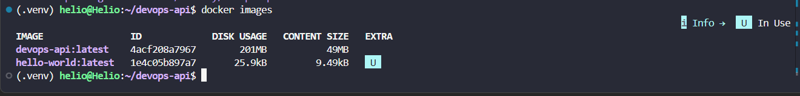
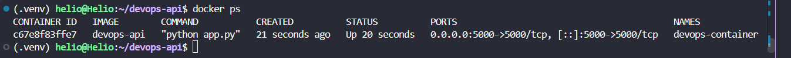
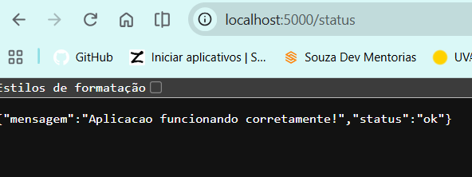

# DevOps API — Práticas 3 e 4

## Sobre o projeto

Este projeto foi desenvolvido como parte das atividades práticas
da disciplina de DevOps do curso de Análise e Desenvolvimento
de Sistemas da Universidade Veiga de Almeida (UVA).

O objetivo é demonstrar a conteinerização de uma aplicação
Python utilizando Docker e a implementação de integração
contínua com GitHub Actions.

## Tecnologias utilizadas

- Python 3.14
- Flask 3.1.3
- Docker
- Ubuntu (WSL 2)
- Git e GitHub
- GitHub Actions

## Funcionalidades

A aplicação disponibiliza dois endpoints:

| Endpoint | Descrição |
|----------|-----------|
| `/` | Retorna uma mensagem de boas-vindas |
| `/status` | Verifica o funcionamento da aplicação |

## Prática 3 — Aplicação com Docker

### Construir a imagem

```bash
docker build -t devops-api .
```

### Executar o contêiner

```bash
docker run -d --name devops-container -p 5000:5000 devops-api
```

### Verificar o contêiner

```bash
docker ps
```

### Testar a aplicação

Acesse no navegador:

- http://localhost:5000
- http://localhost:5000/status

### Parar o contêiner

```bash
docker stop devops-container
```

### Remover o contêiner

```bash
docker rm devops-container
```

## Evidências da Prática 3

As evidências demonstram:

### 1. Imagem Docker construída



### 2. Contêiner em execução



### 3. Aplicação funcionando

.

## Prática 4 — Integração contínua

Nesta etapa, será implementado um pipeline de integração
contínua utilizando GitHub Actions.

O workflow deverá:

1. Executar em pushes na branch principal.
2. Executar em Pull Requests.
3. Construir a imagem Docker.
4. Iniciar um contêiner.
5. Executar testes automatizados.
6. Identificar falhas nos testes.

### Teste de falha proposital

Será introduzido um erro proposital na aplicação para
demonstrar a identificação de falhas pelo pipeline.

Após a correção, os testes serão executados novamente.

Os resultados e links das execuções serão documentados aqui.

## Autor

Projeto acadêmico desenvolvido por Helio Anselmo Filho.

Curso: Análise e Desenvolvimento de Sistemas  
Instituição: Universidade Veiga de Almeida (UVA)
Matrícula: 1250209808